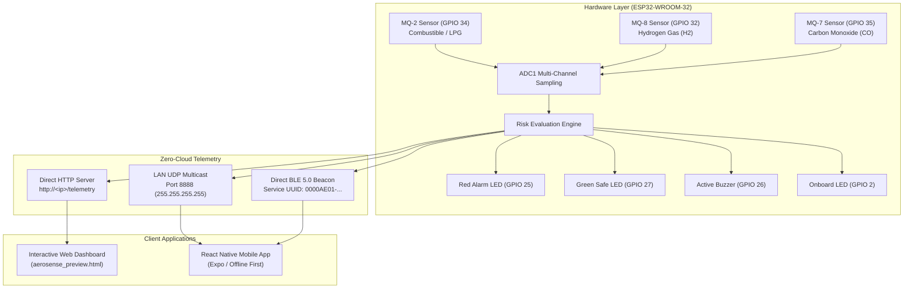

# AeroSense: Autonomous Multi-Gas Leak Detection & Life-Safety Hub

**AeroSense** is an autonomous, ceiling-mounted multi-gas monitoring and life-safety alert platform. Engineered for production facilities and residential spaces prone to gas accumulation, the system detects Flammable Gases / LPG, Hydrogen ($\text{H}_2$), and Carbon Monoxide ($\text{CO}$) in real time. It pairs dedicated ESP32 embedded firmware with a high-contrast React Native mobile emergency dashboard and local web telemetry.

---

## System Architecture



---

## Hardware Pinout Configuration

| Component | Pin / GPIO | Type | Description |
| :--- | :--- | :--- | :--- |
| **MQ-2 Sensor** | `GPIO 34` | Analog Input (`ADC1_CH6`) | Methane, Propane, LPG, Combustible Gas |
| **MQ-8 Sensor** | `GPIO 32` | Analog Input (`ADC1_CH4`) | Hydrogen Gas ($\text{H}_2$) |
| **MQ-7 Sensor** | `GPIO 35` | Analog Input (`ADC1_CH7`) | Carbon Monoxide ($\text{CO}$) |
| **Red Alert LED** | `GPIO 25` | Digital Output | Pulses during Warning (700ms) and Critical (150ms) |
| **Green Safe LED** | `GPIO 27` | Digital Output | Solid ON during Normal safe ambient air |
| **Active Buzzer** | `GPIO 26` | Digital Output | Audible alarm cadence (synchronized with Red LED) |
| **Diagnostic LED** | `GPIO 2` | Digital Output | ESP32 onboard blue status indicator |
| **Power Source** | `5V USB` | Power Supply | 5.0V continuous USB / Mains power supply |

> **ADC Note**: All gas sensors are strictly mapped to **ADC1** pins (GPIOs 32–39), ensuring continuous, uncorrupted analog acquisition without interference from the active Wi-Fi radio (ADC2 is restricted during Wi-Fi transmission).

---

## Safety Thresholds & Alarm Tiers

| Gas Type | Sensor | Advisory Warning | Critical Emergency | Action Directive |
| :--- | :--- | :--- | :--- | :--- |
| **Flammable Gas / LPG** | MQ-2 | $\ge 200\text{ PPM}$ | $\ge 400\text{ PPM}$ | Extinguish open flames, shut off main gas valve |
| **Hydrogen Gas ($\text{H}_2$)** | MQ-8 | $\ge 400\text{ PPM}$ | $\ge 800\text{ PPM}$ | Ventilate space immediately, do not operate switches |
| **Carbon Monoxide ($\text{CO}$)** | MQ-7 | $\ge 25\text{ PPM}$ | $\ge 50\text{ PPM}$ | Evacuate area to fresh air immediately |

---

## Repository Structure

```text
PHY111_FinalProject/
├── firmware/
│   └── aerosense_firmware/
│       └── aerosense_firmware.ino    # ESP32 firmware (Wi-Fi, HTTP, UDP, Sensors, Actuators)
├── mobile_app/
│   ├── App.js                       # Primary React Native emergency monitor & dashboard
│   ├── package.json                 # Mobile dependencies (Expo, Lucide, Reanimated)
│   └── src/
│       └── components/              # Modular UI components (SpeedDial, Modals, StatusGauge)
├── aerosense_preview.html           # Standalone offline browser simulation & preview
└── README.md                        # Documentation & setup guide
```

---

## Getting Started

### 1. Flash the ESP32 Firmware
1. Open [firmware/aerosense_firmware/aerosense_firmware.ino](firmware/aerosense_firmware/aerosense_firmware.ino) in **Arduino IDE 2.x**.
2. Select Board: **ESP32 Dev Module** under `Tools > Board > esp32`.
3. Select Port: Your active COM port (e.g. `COM8`).
4. Click **Upload**. (If the console displays `Connecting......`, hold down the physical **BOOT** button on the ESP32 until the percentage counter starts).
5. Open the **Serial Monitor** at **115200 baud** (with `Newline` enabled).
6. Press **`S`** and Enter in the Serial Monitor at any time to toggle an emergency gas leak simulation!

### 2. Run the Web Preview
Double-click [aerosense_preview.html](aerosense_preview.html) to open the interactive simulation dashboard in any web browser without needing server dependencies.

### 3. Run the Mobile App
```bash
cd mobile_app
npm install
npx expo start
```
Scan the generated QR code using the **Expo Go** app on Android or iOS.

---

## License
Developed for Academic Research & Prototyping (Academic Year 2024–2026).
